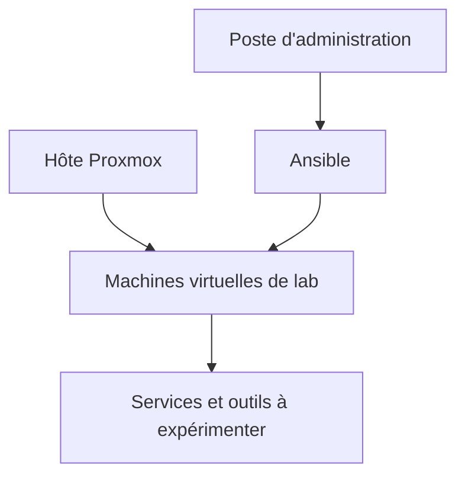

# Homelab Infrastructure

**Un laboratoire personnel pour expérimenter la virtualisation, l'automatisation et l'administration de services.**

J'utilise un environnement de lab sous **Proxmox** pour tester des déploiements avec **Ansible** et explorer les pratiques d'Infrastructure as Code. Ce dépôt présente les thèmes de ces expérimentations et propose un exemple de diagnostic Ansible simple à reproduire.

Les services cités ont été expérimentés à différents moments : leur présence dans cette documentation ne signifie pas qu'ils fonctionnent tous simultanément. Les schémas sont des vues logiques pédagogiques, pas le plan détaillé d'un réseau réel.

## Ce que l'on trouve ici

| Contenu | Intérêt |
| --- | --- |
| [Architecture du lab](docs/architecture.md) | Comprendre le rôle de la virtualisation et les principes de cloisonnement. |
| [Services expérimentés](docs/services.md) | Situer les outils explorés et leurs usages. |
| [Démarche d'automatisation](docs/automatisation.md) | Préparer, tester et documenter un déploiement Ansible. |
| [Exemple de diagnostic Ansible](examples/ansible/README.md) | Vérifier la connexion et afficher des informations système sur une machine de test. |

## Vue d'ensemble



Cette vue représente des rôles fonctionnels ; elle ne décrit ni les flux réels ni une configuration réseau prête à l'emploi.

## Démarrer avec l'exemple

L'exemple nécessite un contrôleur avec Ansible et Python, ainsi qu'une cible de test accessible en SSH avec Python. Il ne déploie pas les services cités dans le dépôt.

```bash
cd examples/ansible
cp inventory.example.yml inventory.local.yml
# Adapter inventory.local.yml à une machine de test autorisée.
ansible-playbook -i inventory.local.yml diagnostic.yml --syntax-check
ansible-playbook -i inventory.local.yml diagnostic.yml
```

La première commande Ansible ne contacte pas la cible. La seconde établit une connexion et collecte des informations système ; ses détails et limites sont décrits dans le [guide de l'exemple](examples/ansible/README.md). Les fichiers d'inventaire locaux sont ignorés par Git.

## Autres projets

- [Ansible Linux Workstation](https://github.com/SebastienLavaux84302/ansible-linux-workstation) : préparation expérimentale de postes RHEL et gestion de dépôts en environnement déconnecté.
- [Security Detection Lab](https://github.com/SebastienLavaux84302/security-detection-lab) : démarche de détection et exemple d'analyse sur des événements fictifs.

## Périmètre et assistance

Ce dépôt est une présentation personnelle et pédagogique. Il ne contient pas les playbooks de déploiement des services ni les configurations réelles de mon environnement. L'exemple Ansible et cette documentation ont été préparés avec l'assistance de **Codex (OpenAI)** ; ils sont à adapter et valider avant usage.
